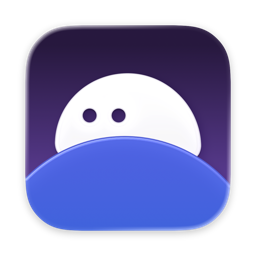

<div align="center">
  <a href="https://github.com/open-dawn/dawn">
    
    <h1>DAWN</h1>
  </a>

  <p>
    An open-source macOS workspace app from OpenDawn.
    <br />
    <a href="https://github.com/open-dawn/dawn/issues/new?template=bug_report.yml">Report Bug</a>
    ·
    <a href="https://github.com/open-dawn/dawn/issues/new?template=feature_request.yml">Request Feature</a>
  </p>
</div>

<!-- TABLE OF CONTENTS -->
<details>
  <summary>Table of Contents</summary>
  <ol>
    <li><a href="#1-about-the-project">About The Project</a></li>
    <li><a href="#2-usage">Usage</a></li>
    <li>
      <a href="#3-installation">Installation</a>
      <ul>
        <li><a href="#31-github-release">GitHub Release</a></li>
        <li><a href="#32-homebrew">Homebrew</a></li>
      </ul>
    </li>
    <li><a href="#4-development">Development</a></li>
    <li><a href="#5-contributing">Contributing</a></li>
    <li><a href="#6-license">License</a></li>
    <li><a href="#7-security">Security</a></li>
  </ol>
</details>

## 1. About The Project

DAWN is an open-source macOS application designed by OpenDawn. It manages workspace contexts: the apps and windows that belong to a workspace, and the switch from one workspace to another.

The first release supports macOS 15 or later on Apple Silicon.

## 2. Usage

A demo video or GIF will be added here.

Place the file at `docs/media/demo.gif`, then replace this note with:

```markdown

```

## 3. Installation

DAWN runs on macOS 15 or later on Apple Silicon. Install a published build. Building from source is covered in [Development](#04-development).

### 3.1. GitHub Release

Download the latest disk image from [GitHub Releases](https://github.com/open-dawn/dawn/releases). The file is named `DAWN-<version>.dmg`. It is signed and notarized. Open it and drag DAWN into `/Applications`.

### 3.2. Homebrew

Homebrew is not available yet.

## 4. Development

These steps build DAWN from source. Continuous integration uses the same generate, lint, and test commands.

You need:
* An Apple Silicon Mac
* macOS 15 or later
* [Xcode](https://developer.apple.com/xcode/) 26.5
* [XcodeGen](https://github.com/yonaskolb/XcodeGen) 2.46.0
* [SwiftLint](https://github.com/realm/SwiftLint) 0.65.1

```sh
brew install xcodegen swiftlint
git clone https://github.com/open-dawn/dawn.git
cd dawn
xcodegen generate
open dawn.xcodeproj
```

`xcodegen generate` writes `dawn.xcodeproj` from `project.yml`. Continuous integration pins XcodeGen 2.46.0 and SwiftLint 0.65.1. A newer Homebrew formula can differ from those pins.

Run a scheme:

* `dawnApp` launches `DAWN.app`
* `dawnAgent` launches the menu bar agent
* `dawn` is the scheme continuous integration tests

```sh
swiftlint lint --strict
xcodebuild \
  -project dawn.xcodeproj \
  -scheme dawn \
  -configuration Debug \
  -destination "platform=macOS,arch=arm64" \
  test
```

## 5. Contributing

Contributions are welcome. Please read the [Code of Conduct](CODE_OF_CONDUCT.md) and the full guide in [CONTRIBUTING.md](CONTRIBUTING.md) before opening a pull request.

1. Fork the project
2. Create a branch from `main`
3. Commit with the message format in [.github/.gitmessage](.github/.gitmessage)
   ```
   <tag>(scope): <short description>
   ```
4. Open a pull request into `main`

### 5.1. Contributors

<a href="https://github.com/open-dawn/dawn/graphs/contributors">
  
</a>

## 6. License

Distributed under the GNU General Public License v3.0. See [LICENSE.txt](LICENSE.txt) for more information.

## 7. Security

Report vulnerabilities in private. See [SECURITY.md](SECURITY.md).
